

  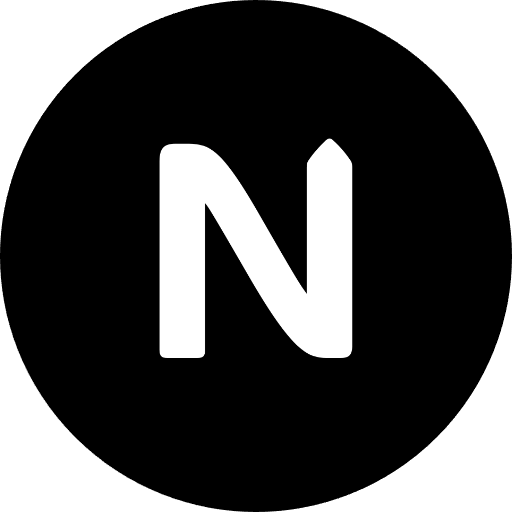

<h1 align="left">Nitterium</h1>

  
  
  
  
  
  
  
  <a href="https://github.com/kaleedtc/Nitterium/releases/latest">
  

     
**Nitterium** lets you browse public Twitter/X content through Nitter and Teapot instances without a Twitter/X account. Save profiles as local subscriptions, organize them into groups, and browse their posts in combined feeds.

### 🤔 Why this?
While browsing Nitter on Android, I needed a way to subscribe to accounts I was interested in following, along with some customization options. That led to the creation of this app!

### How it works

Nitterium loads pages from your selected Nitter or Teapot instance in an Android WebView, much like browsing the site. Combined feeds use the instance's own timeline pages. The app does not perform background crawling or bulk scraping of tweets.

To support its native features, Nitterium reads parts of the pages you open, such as avatar URLs, image links, and error messages. It also keeps local page snapshots to restore your reading position. Subscriptions and groups are managed locally on your device.

> [!Important]
> - Nitterium depends on independently operated Nitter and Teapot instances. Availability, supported features, and feed limits vary between instances. If one stops working or becomes rate limited, try another.
> - Subscriptions and groups are stored on your device. Browsing requests go to the instance you choose, and some media may load directly from X depending on your settings.

---

## ✨ FEATURES

* 🔒 **Privacy First**: No ads, no tracking, and no Twitter/X account required.
* 📌 **Local subscriptions**: Save profiles on your device, sort them by username or subscription date, or arrange them manually.
* 🗂️ **Grouped feeds**: Browse posts from a selected group. Give groups their own names, icons, and colors.
* 👆 **Long-Press & Sharing**: Easily share, copy, or open links, tweets, and media directly via intuitive long-press actions.
* 🖼️ **Intuitive Image Viewer**: Easily exit the image viewer by swiping up or down, and save images directly to your device.
* 🔄 **Pull-to-Refresh**: Swipe down to reload content seamlessly.
* 🎨 **Dynamic Theming**: Beautiful Material 3 design that automatically adapts to your system theme and wallpaper (Android 12+).
* 🚀 **Backup and restore**: Export subscriptions, groups, and settings, and review a backup before restoring it. Import subscriptions from QuaX app backups.
* 🔗 **Supported links**: Open supported Twitter/X and Nitter links in the app.
* 🌍 **RTL Support**: Supports RTL content by default.
* ❤️ **Instance selection**: Choose a built-in instance or add your own. Switch from an unavailable instance while keeping the current page.

---

## 📥 INSTALLATION

Nitterium can be downloaded from:
- **GitHub Releases**: Get the latest APK directly from the [Releases page](https://github.com/kaleedtc/Nitterium/releases).
- **Obtainium**: Keep track of direct APK updates seamlessly.

  <a href="https://github.com/kaleedtc/Nitterium/releases">
    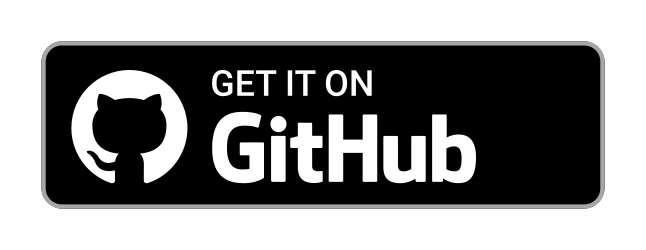
  </a>
 
  <a href="https://apps.obtainium.imranr.dev/redirect?r=obtainium://add/https://github.com/kaleedtc/Nitterium">
    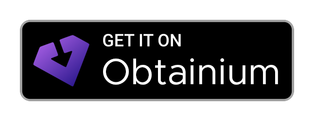
  </a>
  <a href="https://apt.izzysoft.de/fdroid/index/apk/com.kaleedtc.nitterium">
    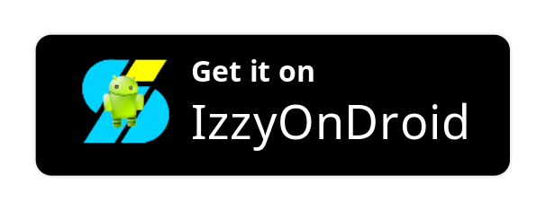</a>

### 🛡️ Verification

To ensure the authenticity of the APK, you can verify its SHA-256 fingerprint:
`3F:92:8C:35:E5:61:61:A0:63:80:74:9B:BC:F8:02:A6:8D:E6:7D:8D:88:10:0A:B1:79:6E:4E:BE:7B:27:DA:AF`

---

## 🔐 PERMISSIONS

Nitterium respects your privacy and requests only the absolute minimum permissions required to function:

**INTERNET**: Required to fetch content and images from Nitter instances over the network.

**ACCESS_NETWORK_STATE**: Used to check if the device is connected to the internet before attempting to load content, providing a better user experience when offline.

---

## 📱 SCREENSHOTS

  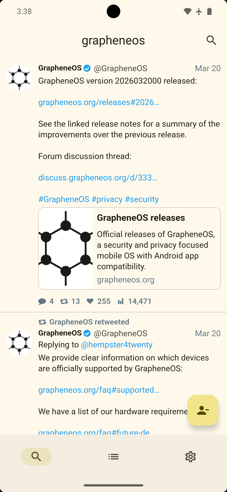
  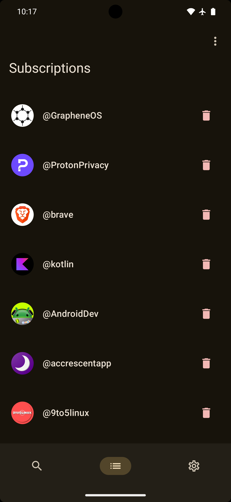
  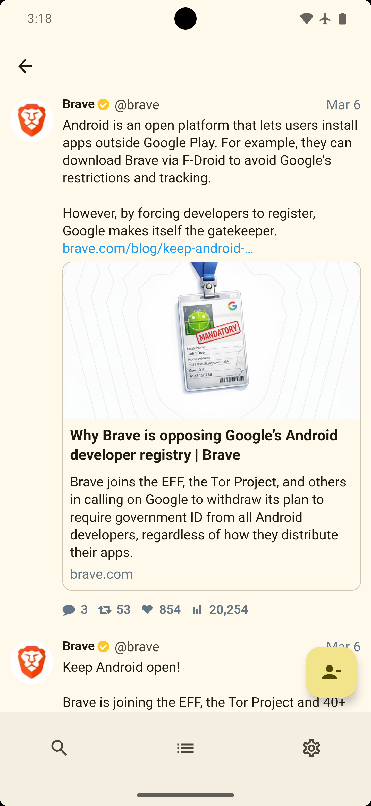
  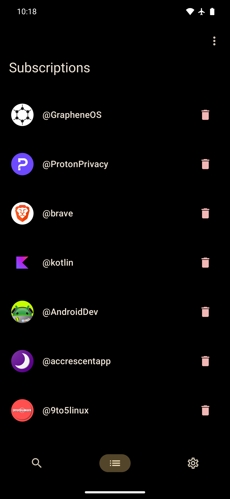

  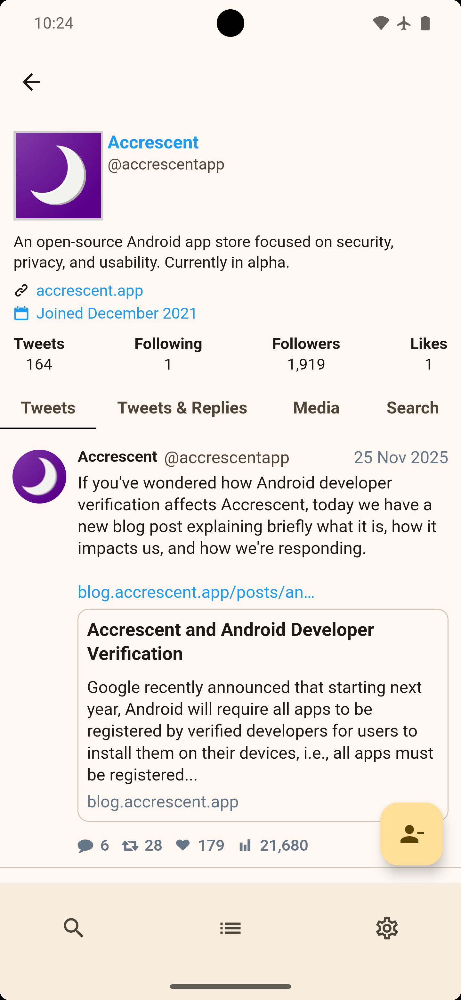
  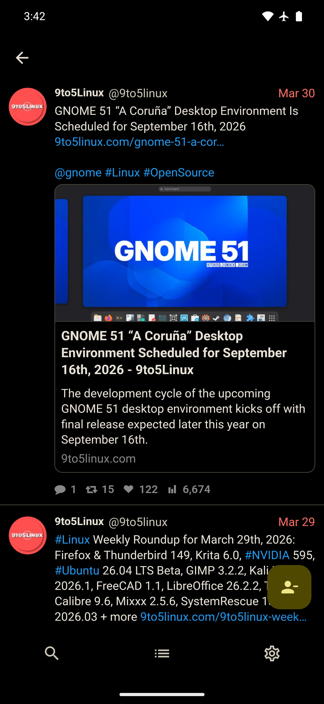
  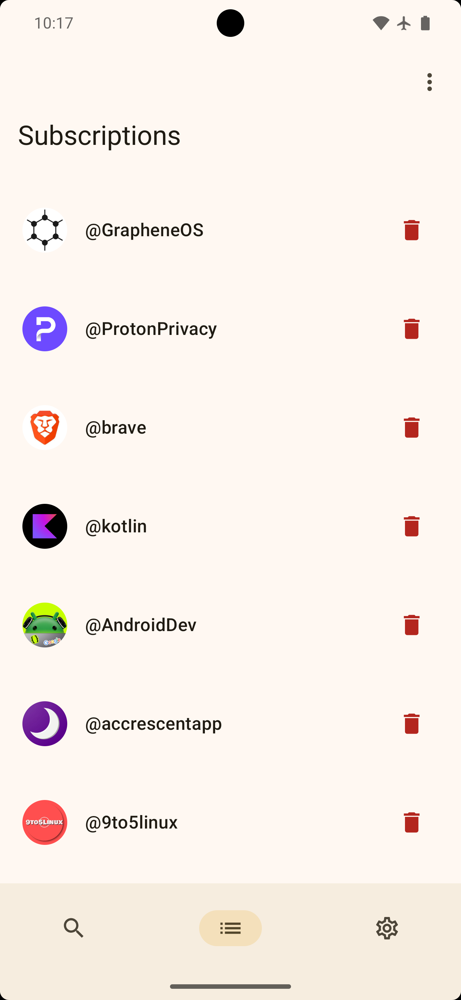
  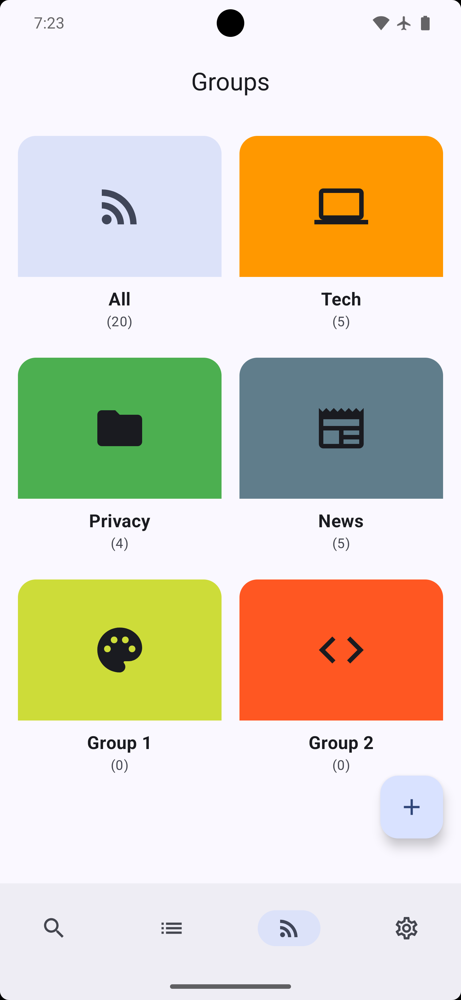

---

## 🛠️ BUILT WITH

* **Kotlin**
* **Jetpack Compose**
* **Material 3 Components**
* **Coil 3**
* **Jetpack DataStore & Kotlinx Serialization**

---

## 📜 LICENSE

This project is distributed under the MIT License. See [LICENSE](https://github.com/kaleedtc/Nitterium/blob/main/LICENSE) for more information.

---

## 🤝 ACKNOWLEDGMENTS

- A huge thanks to the [Nitter](https://github.com/zedeus/nitter) maintainers and the individuals hosting Nitter instances. Without their hard work and dedication to privacy, this app would not be possible.
- All the contributors who will help make this app better.

## Donate
If you find Nitterium valuable, please consider donating to the project via options below:

<noscript></noscript>

**BTC:**
`bc1q92235uhffydjj5w5av3fs96vn0n6g0zprx7rhk`

**BCH:**
`qqsnx346jfddmvtqws5kmadlrut4vk7fg5hxysldfe`

**LTC:**
`ltc1q3ck68nwpj8zm7qsxegsvjxcayatsj7duze2zvn`

**ETH:**
`0xD2b51F35a886C59f12b416bD772Dc3371dc8189D`

**SOL:**
`6CHBgZXJMgGTu7yaY3o1dTBTR3YH7DqoVHv9QtiKmaT4`

**XMR:**
`46Sc8LznRrhQz6Qwng12RZ13W3V6tj5LDF7cJJ5yL7Li62vfLDFBktbcZ2wqk3XmDS3dkRVfcFd65LwSJEw1Xigp3HETSz5`

**ZEC:**
`u14mnfch36cn7wpxdazal5cr8gvenmnjxx8jsgfxtn4q04xhx5hqf0xyr6xkmczmjgvuth6fxj08x8yd36ud6tcv7aase6e4txkccscls2`
